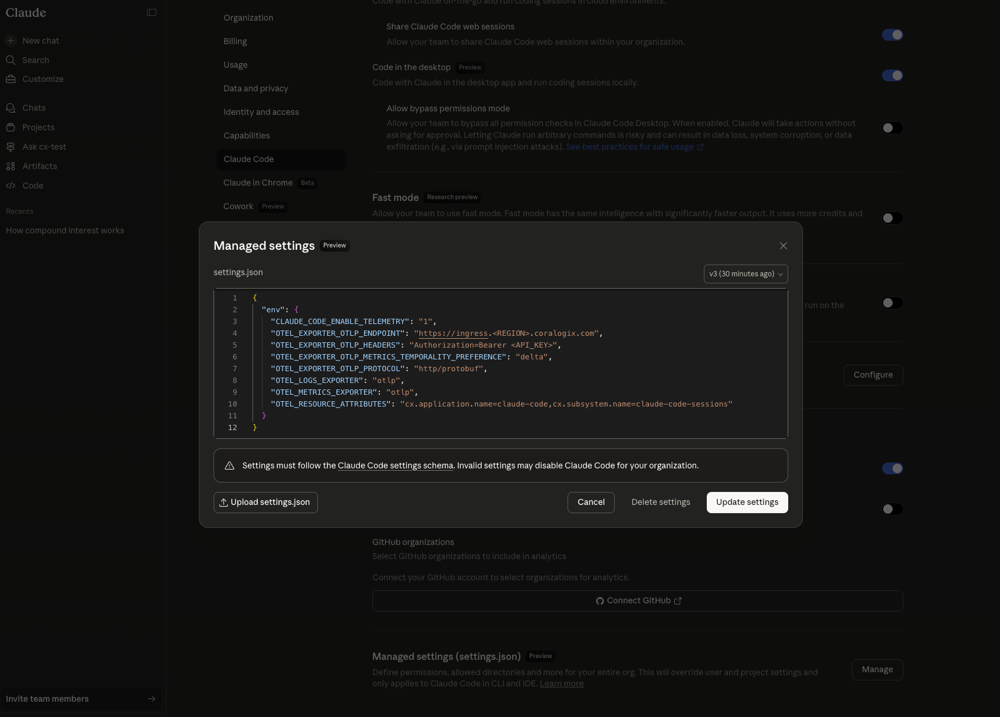
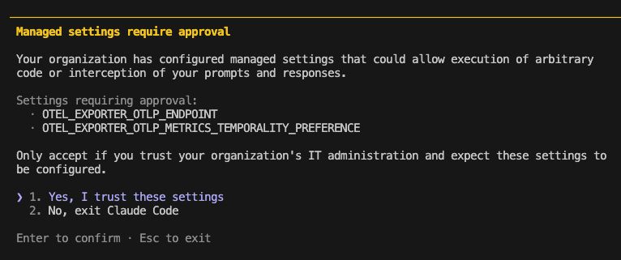
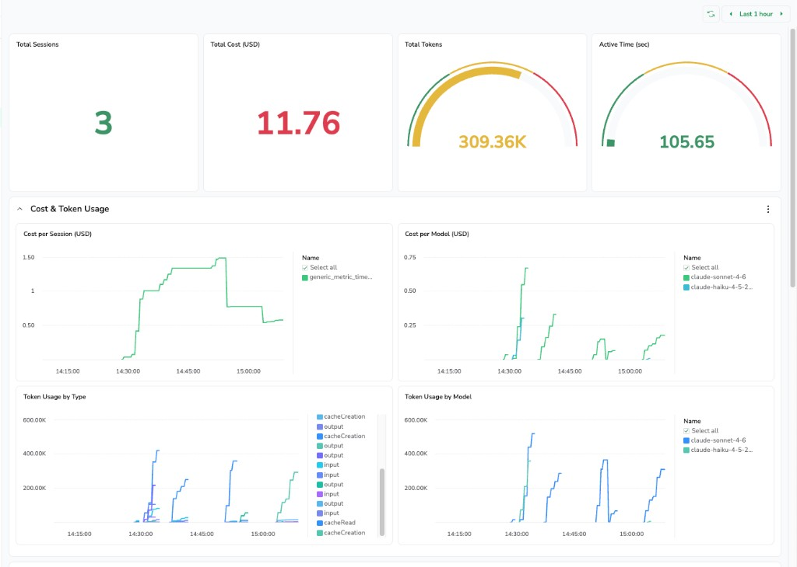

# Claude Code - Coralogix

Ship every Claude Code session — token usage, costs, code changes, tool decisions, and prompt logs — directly into Coralogix using Claude Code's built-in OpenTelemetry support.

No agents. No wrappers. No code changes to your projects. Claude Code emits OTLP natively; you just point it at your Coralogix ingress endpoint.

---

## How it works

Claude Code exposes telemetry via the [OpenTelemetry SDK](https://docs.anthropic.com/en/docs/claude-code/monitoring-usage) when `CLAUDE_CODE_ENABLE_TELEMETRY=1` is set. This repo provides:

- `activate.sh` — exports all required env vars into your shell in one step
- `.env` — stores your Coralogix API key and endpoint (git-ignored)
- `coralogix-dashboard.json` — a pre-built dashboard ready to import

---

## Signals sent to Coralogix

### Metrics

All metrics use **delta temporality** — the format Coralogix expects for counters. They show up under **Metrics Explorer** when you search `claude_code`.

| Metric | Labels | What it tracks |
|---|---|---|
| `claude_code_session_count_total` | `session_id`, `user_account_uuid` | Sessions started |
| `claude_code_token_usage_tokens_total` | `model`, `type` | Tokens by model and type (`input`, `output`, `cacheRead`, `cacheCreation`) |
| `claude_code_cost_usage_USD_total` | `model` | Estimated USD cost per model |
| `claude_code_lines_of_code_count_total` | `type` | Lines added and removed |
| `claude_code_commit_count_total` | — | Git commits made |
| `claude_code_pull_request_count_total` | — | Pull requests created |
| `claude_code_code_edit_tool_decision_total` | `decision`, `source`, `tool_name`, `language` | Accept / reject on code edits |
| `claude_code_active_time_total_s_total` | `type` | Seconds Claude was actively processing (`cli` = AI/tool work, `user` = keyboard interaction) |

### Log events

Log events are routed to the subsystem you configure in `.env`. Query them in **Coralogix Logs** using DataPrime or Lucene.

| Event type | Key attributes |
|---|---|
| `claude_code.user_prompt` | `session.id`, `user.account_uuid`, `prompt` (opt-in), `model` |
| `claude_code.api_request` | `model`, token counts, cost, latency |
| `claude_code.api_error` | `status`, error message |
| `claude_code.tool_result` | tool name, duration, outcome, `tool_parameters` (JSON — Bash: `bash_command`, `full_command`, `description`; MCP/Skill: opt-in via `OTEL_LOG_TOOL_DETAILS=1`) |
| `claude_code.tool_decision` | tool name, `decision`, `source` |

Every signal carries `session.id`, `user.account_uuid`, `user.email`, `organization.id`, `app.version`, and `terminal.type`.

---

## Setup

There are two deployment paths depending on whether you need org-wide automatic rollout or per-developer setup.

---

### Option A — Org-wide via Claude Code Managed Settings (recommended for teams)

Claude Code's [server-managed settings](https://docs.anthropic.com/en/docs/claude-code/managed-settings) (Public Beta) lets you push the Coralogix configuration to every developer in your organization automatically. No shell scripts, no `.env` distribution, no per-developer action required.

**Requirements:** Claude for Teams or Enterprise · Claude Code ≥ 2.1.38

#### 1. Open the admin console

In [Claude.ai](https://claude.ai/), navigate to **Admin Settings → Claude Code → Managed Settings** and click **Manage**.

#### 2. Paste the settings JSON

```json
{
  "env": {
    "CLAUDE_CODE_ENABLE_TELEMETRY": "1",
    "OTEL_METRICS_EXPORTER": "otlp",
    "OTEL_LOGS_EXPORTER": "otlp",
    "OTEL_EXPORTER_OTLP_PROTOCOL": "http/protobuf",
    "OTEL_EXPORTER_OTLP_ENDPOINT": "<YOUR_CX_OTLP_ENDPOINT>",
    "OTEL_EXPORTER_OTLP_HEADERS": "Authorization=Bearer <YOUR_CX_API_KEY>",
    "OTEL_RESOURCE_ATTRIBUTES": "cx.application.name=claude-code,cx.subsystem.name=claude-code-sessions",
    "OTEL_EXPORTER_OTLP_METRICS_TEMPORALITY_PREFERENCE": "delta"
  }
}
```

Replace the placeholders with your values (see the credentials section below for OTLP endpoint by region).

#### 3. Click "Add settings"



Settings are delivered to all Claude Code clients at their next startup, or within the hourly polling cycle for running sessions.

#### What developers experience

On their next `claude` startup, developers see a one-time security approval dialog listing the env vars being configured by the org. They select **Yes, I trust these settings** and Claude Code restarts. Telemetry flows from that point forward — no further action needed.



> **Note on OTEL and restarts:** OpenTelemetry configuration takes effect on a full Claude Code restart, not just session reload. After the approval dialog, Claude Code restarts automatically.

---

### Option B — Per-developer setup

Use this if your organization is not on Claude for Teams/Enterprise, or if you prefer not to use server-managed settings.

#### 1. Configure your Coralogix credentials

```bash
cp .env.example .env
```

Open `.env` and fill in:

```
CX_API_KEY=<your-send-your-data-api-key>
CX_OTLP_ENDPOINT=https://ingress.eu1.coralogix.com
CX_APPLICATION_NAME=claude-code
CX_SUBSYSTEM_NAME=claude-code-sessions
```

Find your Send-Your-Data API key under **Settings → API Keys** in your Coralogix tenant.

**OTLP ingress by region:**

| Domain | OTLP endpoint |
|---|---|
| `us1.coralogix.com` | `https://ingress.us1.coralogix.com` |
| `us2.coralogix.com` | `https://ingress.us2.coralogix.com` |
| `eu1.coralogix.com` | `https://ingress.eu1.coralogix.com` |
| `eu2.coralogix.com` | `https://ingress.eu2.coralogix.com` |
| `ap1.coralogix.com` | `https://ingress.ap1.coralogix.com` |
| `ap2.coralogix.com` | `https://ingress.ap2.coralogix.com` |
| `ap3.coralogix.com` | `https://ingress.ap3.coralogix.com` |

#### 2. Activate telemetry and start Claude

```bash
source activate.sh
claude
```

`activate.sh` exports all OTEL variables into your current shell. It must be sourced (not executed) so the variables persist. Re-run it in each new terminal, or make it permanent as below.

#### 3. Make it permanent

Add the following to `~/.zshrc` (or `~/.bashrc`) so every terminal automatically has telemetry enabled:

```bash
if [ -f "$HOME/path/to/claude-code-coralogix/.env" ]; then
  set -a; source "$HOME/path/to/claude-code-coralogix/.env"; set +a
fi
export CLAUDE_CODE_ENABLE_TELEMETRY=1
export OTEL_METRICS_EXPORTER=otlp
export OTEL_LOGS_EXPORTER=otlp
export OTEL_EXPORTER_OTLP_PROTOCOL=http/protobuf
export OTEL_EXPORTER_OTLP_ENDPOINT="${CX_OTLP_ENDPOINT}"
export OTEL_EXPORTER_OTLP_HEADERS="Authorization=Bearer ${CX_API_KEY}"
export OTEL_RESOURCE_ATTRIBUTES="cx.application.name=${CX_APPLICATION_NAME},cx.subsystem.name=${CX_SUBSYSTEM_NAME}"
export OTEL_EXPORTER_OTLP_METRICS_TEMPORALITY_PREFERENCE=delta
```

Alternatively, use Claude Code's own [settings file](https://docs.anthropic.com/en/docs/claude-code/settings) at `~/.claude/settings.json`:

```json
{
  "env": {
    "CLAUDE_CODE_ENABLE_TELEMETRY": "1",
    "OTEL_METRICS_EXPORTER": "otlp",
    "OTEL_LOGS_EXPORTER": "otlp",
    "OTEL_EXPORTER_OTLP_PROTOCOL": "http/protobuf",
    "OTEL_EXPORTER_OTLP_ENDPOINT": "https://ingress.eu1.coralogix.com",
    "OTEL_EXPORTER_OTLP_HEADERS": "Authorization=Bearer <YOUR_CX_API_KEY>",
    "OTEL_RESOURCE_ATTRIBUTES": "cx.application.name=claude-code,cx.subsystem.name=claude-code-sessions",
    "OTEL_EXPORTER_OTLP_METRICS_TEMPORALITY_PREFERENCE": "delta"
  }
}
```

---

## Session-spans hook (macOS & Windows)

The hook sends one span for each Claude Code session event. AI Center uses the spans to link each session to the git branches it works on. Paste this into the admin console's **Managed settings** dialog, or deliver it with MDM (see [Deploy with Jamf](#deploy-with-jamf-macos)). The same JSON is available as a ready-to-edit file at [`hooks/managed-settings.example.json`](hooks/managed-settings.example.json) — replace the `<YOUR_…>` placeholders with your values.

```json
{
  "availableModels": [
    "sonnet",
    "haiku",
    "opus",
    "fable-5"
  ],
  "env": {
    "CLAUDE_CODE_ENABLE_TELEMETRY": "1",
    "CLAUDE_CODE_ENHANCED_TELEMETRY_BETA": "1",
    "OTEL_EXPORTER_OTLP_ENDPOINT": "<YOUR_CX_OTLP_ENDPOINT>",
    "OTEL_EXPORTER_OTLP_HEADERS": "Authorization=Bearer <YOUR_CX_API_KEY>",
    "OTEL_EXPORTER_OTLP_METRICS_TEMPORALITY_PREFERENCE": "delta",
    "OTEL_EXPORTER_OTLP_PROTOCOL": "http/protobuf",
    "OTEL_LOGS_EXPORTER": "otlp",
    "OTEL_LOGS_EXPORT_INTERVAL": "1000",
    "OTEL_METRICS_EXPORTER": "otlp",
    "OTEL_METRIC_EXPORT_INTERVAL": "1000",
    "OTEL_RESOURCE_ATTRIBUTES": "cx.application.name=claude-code,cx.subsystem.name=<YOUR_SUBSYSTEM_NAME>,cx.integration.source.version=1.0.0,cx.integration.source.type=claude_code_agent",
    "OTEL_TRACES_EXPORTER": "otlp",
    "OTEL_TRACES_EXPORT_INTERVAL": "1000"
  },
  "hooks": {
    "SessionStart": [
      {
        "hooks": [
          {
            "async": true,
            "command": "case \"$(uname -s)\" in Darwin) [ -x /usr/local/bin/claude.sh ] && exec /bin/sh /usr/local/bin/claude.sh; exit 0;; MINGW*|MSYS*|CYGWIN*) [ -f \"C:/ProgramData/Coralogix/claude-code/claude.ps1\" ] && exec powershell.exe -NoProfile -ExecutionPolicy Bypass -File C:/ProgramData/Coralogix/claude-code/claude.ps1; exit 0;; *) exit 0;; esac",
            "type": "command"
          }
        ]
      }
    ],
    "UserPromptSubmit": [
      {
        "hooks": [
          {
            "async": true,
            "command": "case \"$(uname -s)\" in Darwin) [ -x /usr/local/bin/claude.sh ] && exec /bin/sh /usr/local/bin/claude.sh; exit 0;; MINGW*|MSYS*|CYGWIN*) [ -f \"C:/ProgramData/Coralogix/claude-code/claude.ps1\" ] && exec powershell.exe -NoProfile -ExecutionPolicy Bypass -File C:/ProgramData/Coralogix/claude-code/claude.ps1; exit 0;; *) exit 0;; esac",
            "type": "command"
          }
        ]
      }
    ],
    "PostToolUse": [
      {
        "matcher": "Edit|MultiEdit|Write|NotebookEdit",
        "hooks": [
          {
            "async": true,
            "command": "case \"$(uname -s)\" in Darwin) [ -x /usr/local/bin/claude.sh ] && exec /bin/sh /usr/local/bin/claude.sh; exit 0;; MINGW*|MSYS*|CYGWIN*) [ -f \"C:/ProgramData/Coralogix/claude-code/claude.ps1\" ] && exec powershell.exe -NoProfile -ExecutionPolicy Bypass -File C:/ProgramData/Coralogix/claude-code/claude.ps1; exit 0;; *) exit 0;; esac",
            "type": "command"
          }
        ]
      }
    ],
    "CwdChanged": [
      {
        "hooks": [
          {
            "async": true,
            "command": "case \"$(uname -s)\" in Darwin) [ -x /usr/local/bin/claude.sh ] && exec /bin/sh /usr/local/bin/claude.sh; exit 0;; MINGW*|MSYS*|CYGWIN*) [ -f \"C:/ProgramData/Coralogix/claude-code/claude.ps1\" ] && exec powershell.exe -NoProfile -ExecutionPolicy Bypass -File C:/ProgramData/Coralogix/claude-code/claude.ps1; exit 0;; *) exit 0;; esac",
            "type": "command"
          }
        ]
      }
    ],
    "SessionEnd": [
      {
        "hooks": [
          {
            "command": "case \"$(uname -s)\" in Darwin) [ -x /usr/local/bin/claude.sh ] && exec /bin/sh /usr/local/bin/claude.sh; exit 0;; MINGW*|MSYS*|CYGWIN*) [ -f \"C:/ProgramData/Coralogix/claude-code/claude.ps1\" ] && exec powershell.exe -NoProfile -ExecutionPolicy Bypass -File C:/ProgramData/Coralogix/claude-code/claude.ps1; exit 0;; *) exit 0;; esac",
            "type": "command"
          }
        ]
      }
    ]
  }
}
```

No credentials appear in the `command` — the endpoint, key, and resource attributes are configured exactly **once**, in the `env` block above. This single settings block works unchanged on macOS and Windows: the same managed/remote settings can be pushed to every machine regardless of OS.

**Zero fleet assumptions.** The hook is designed for heterogeneous enterprise fleets — it assumes nothing about what's installed and requires no binaries (nothing to sign, notarize, or keep per-arch builds of):
- **macOS** (`hooks/claude.sh`): uses only tools that ship with macOS itself — `/bin/sh`, `plutil` (JSON parsing), `curl` (HTTPS). Works under GUI-launched Claude Code with a bare-bones `PATH`.
- **Windows** (`hooks/claude.ps1`): requires only Windows PowerShell 5.1, which ships with every Windows 10/11.
- `git` is optional on both, and resolved by absolute path rather than through `PATH` — the hook checks `/opt/homebrew`, `/usr/local`, the developer-tools locations, then anything on `PATH` that is not the `/usr/bin/git` stub (execing that stub is what pops Apple's install dialog on machines without the tools). So a Homebrew git still works under the bare-bones `PATH`; on a machine with no git, the span has no `vcs_*` attributes.
- Data is sent as **OTLP/JSON** (`Content-Type: application/json`) to the same ingress endpoint — semantically identical to the protobuf encoding, but buildable with OS-native tools.

**What the hook sends:** one OTLP/JSON span to `/v1/traces` for each of `SessionStart`, `UserPromptSubmit`, `CwdChanged`, `SessionEnd`, and `PostToolUse` of `Edit`, `MultiEdit`, `Write` and `NotebookEdit`. The hook ignores all other events and tools, so an older registration on every tool sends no extra spans.
- **Span:** name `agent_hook.<event>`, kind internal, start and end at the event time.
- **Attributes:** `agent_name` (`claude-code`), `hook_event`, `session_id`, `user_email` (the claude.ai login email cached in `~/.claude.json`, when present; it can remain after the user switches to an API key), `tool_name` (edits only), and, when the repository has an `origin`, `vcs_repository_url_full` (no user, password, query or fragment), `vcs_repository_name` (`owner/repo`) and `vcs_ref_head_name` (the branch; none on a detached HEAD). The repository is the one of the edited file for an edit, of the new directory for `CwdChanged`, and of the working directory for the other events.
- **Resource:** `service.name=claude-code-hook`, `cx.source.integration.type=claude_code_agent`, and `cx.application.name` / `cx.subsystem.name` from `OTEL_RESOURCE_ATTRIBUTES` when set.
- **Trace:** a span sent during a turn joins the turn's trace from `TRACEPARENT`, as a child of `claude_code.interaction`. This needs Claude Code tracing on: `CLAUDE_CODE_ENHANCED_TELEMETRY_BETA=1` and `OTEL_TRACES_EXPORTER=otlp`. `SessionStart`, `SessionEnd`, and every span of a session without tracing, share one trace per session: the first 32 hex characters of SHA-256(`session_id`).
- **Never sent:** prompts, tool input or output, local paths, credentials.

The hook reads the event, stamps its time, and starts a background process that runs git and the POST. So the session never waits for the network, and the send completes after `SessionEnd` and after `claude -p` exits.

**How the OS disambiguation works:** Claude Code executes hook commands through `sh` on macOS and **Git Bash** on Windows, so a single `case "$(uname -s)"` branches both — `Darwin` runs the sh hook, `MINGW*/MSYS*` runs PowerShell with the ps1 hook, anything else is a silent no-op. Each branch guards on the hook file existing (`[ -x … ]` / `[ -f … ]`) and otherwise exits 0, so during rollout — when the managed settings can reach a machine before the MDM policy has staged the hook file — the command is a clean no-op instead of a per-tool-use error. Deploy targets:
- **macOS:** `/usr/local/bin/claude.sh`, via `hooks/deploy-jamf.sh` (a Jamf Policy script)
- **Windows:** `C:\ProgramData\Coralogix\claude-code\claude.ps1`, via `hooks/deploy-windows.ps1` (run as Administrator / pushed via Intune as SYSTEM). Forward slashes in the `command` avoid backslash-escaping inside JSON; this is where *our hook* lives — distinct from Claude Code's own `C:\Program Files\ClaudeCode\managed-settings.json`, which the hook *reads* for config.

**How the hook gets its config (single source of truth):** Claude Code does not reliably propagate the settings `env` block to hook subprocesses — `OTEL_*` are stripped, and on Windows the whole block is dropped ([claude-code#20112](https://github.com/anthropics/claude-code/issues/20112)) — so the hook cannot read its environment. Instead, both hooks read the same Claude Code managed settings that already hold the telemetry config and pull the three values (`OTEL_EXPORTER_OTLP_ENDPOINT`, `OTEL_EXPORTER_OTLP_HEADERS`, `OTEL_RESOURCE_ATTRIBUTES`) straight from their `env` block. For each value they use the first source that sets it, in the [order Claude Code uses](https://code.claude.com/docs/en/managed-settings#how-claude-code-combines-managed-sources): the server-managed cache (`~/.claude/remote-settings.json`, written when settings come from the admin console), the MDM policy (macOS configuration profile `com.anthropic.claudecode` under `/Library/Managed Preferences/`, Windows `HKLM\SOFTWARE\Policies\ClaudeCode\Settings`), the endpoint-managed file (macOS `/Library/Application Support/ClaudeCode/managed-settings.json`, Windows `C:\Program Files\ClaudeCode\managed-settings.json`), then `~/.claude/settings.json`. So the hook sends to the same endpoint, with the same key, as Claude Code's native telemetry, and you configure the `env` block only once.

### Deploy with Jamf (macOS)

1. **Policy:** add [`hooks/deploy-jamf.sh`](hooks/deploy-jamf.sh) as a Jamf script and run it in a policy. It writes the hook to `/usr/local/bin/claude.sh` (root-owned, mode 755). Its embedded copy is byte-for-byte identical to `hooks/claude.sh`.
2. **Configuration profile:** fill in the `<YOUR_…>` values in a copy of [`hooks/managed-settings.example.json`](hooks/managed-settings.example.json), then convert it to a plist:

   ```bash
   plutil -convert xml1 -o com.anthropic.claudecode.plist managed-settings.json
   ```

   In Jamf Pro, create a configuration profile with an **Application & Custom Settings → Upload** payload, preference domain `com.anthropic.claudecode`, and upload the plist. The plist holds your send-data key: keep it out of git.

   If the Mac also gets server-managed settings from the claude.ai admin console, Claude Code takes `hooks` from the admin console only and ignores the hooks in the profile; only `env` merges across the sources. In that case, replace the `hooks` block in the admin console with the `hooks` block of the example, so the run line there is the same as here.
3. **Scope** the policy and the profile to the same test Mac. The order does not matter: until the hook file exists, the hook command exits 0 and does nothing.
4. **Check on the Mac:**
   - `/status` in Claude Code shows `Enterprise managed settings (plist)` under **Setting sources** (or the remote settings, when the admin console delivers settings too).
   - `/hooks` in Claude Code lists the run line of the example for `SessionStart`, `UserPromptSubmit`, `PostToolUse`, `CwdChanged` and `SessionEnd`.
   - `ls -l /usr/local/bin/claude.sh` shows `-rwxr-xr-x root wheel`.
   - Start a session in a git repository, send a prompt, and ask for one file edit. After about a minute, the `agent_hook.SessionStart`, `agent_hook.UserPromptSubmit` and `agent_hook.PostToolUse` spans of that session are in the `ai.raw.anthropic.claude_code.spans` dataset (restricted by default: grant read access in its access policy):

     ```
     source ai.raw.anthropic.claude_code.spans | filter $l.operationName.startsWith('agent_hook')
     ```
   - If no span arrives, `~/.claude/coralogix-hook-last-error.txt` holds the time and HTTP status of the last failed send.

> For manual testing both hooks accept overrides: `--otlp-endpoint` / `--otlp-headers` / `--resource-attributes` / `--settings-file=<path>` (sh) and the equivalent `-OtlpEndpoint` / `-OtlpHeaders` / `-ResourceAttributes` / `-SettingsFile` (PowerShell). `hooks/test-hook-local.sh` spawns a hook exactly the way Claude Code does (sh + event on stdin).

---

## Pre-built dashboard

Import `coralogix-dashboard.json` for an instant view of all signals.



**Sections:**

| Section | What you see |
|---|---|
| **KPI Bar** | Sessions · Cost · Tokens · Active Time · Lines Changed · Commits — all as number cards |
| **Session Activity** | Sessions over time · Avg duration · Tokens per session |
| **Cost & Token Breakdown** | Cost/session · Cost by model · Tokens by model · Tokens by type · API token volume · Cost per token |
| **Code Impact** | Lines added/removed by type · Commits over time · Aggregate line changes |
| **Code Edit Behaviour** | Acceptance rate arc gauge · Decisions by type · Decision volume over time |
| **Prompt Log** | Live DataPrime table — timestamp · user · session · model · prompt text |

**To import:**
1. In your Coralogix tenant go to **Dashboards → New Dashboard**
2. Click the menu icon → **Import from JSON**
3. Paste the contents of `coralogix-dashboard.json` and save

---

## Advanced configuration

| Variable | Default | Purpose |
|---|---|---|
| `OTEL_METRIC_EXPORT_INTERVAL` | `60000` ms | How often metrics are flushed — lower to `10000` when testing |
| `OTEL_LOGS_EXPORT_INTERVAL` | `5000` ms | Log flush interval |
| `OTEL_LOG_USER_PROMPTS` | off | Set to `1` to include prompt text in `claude_code.user_prompt` log events |
| `OTEL_LOG_TOOL_DETAILS` | off | Set to `1` to add MCP server and tool names to tool events |
| `OTEL_RESOURCE_ATTRIBUTES` | — | Add custom dimensions, e.g. `team=platform,env=prod` |
| `OTEL_METRICS_INCLUDE_SESSION_ID` | `true` | Attaches `session.id` to metric labels — disable to reduce cardinality |
| `OTEL_METRICS_INCLUDE_ACCOUNT_UUID` | `true` | Attaches `user.account_uuid` to metric labels |

---

## Privacy & sensitive data

The following fields may contain sensitive data:

- `tool_parameters` (`claude_code.tool_result`) — always emitted for Bash tool; includes `bash_command`, `full_command`, and `description`. Most likely source of sensitive data — commands may contain secrets, file paths, or internal URLs. No opt-out. MCP/Skill tools only emit this field when `OTEL_LOG_TOOL_DETAILS=1`
- `prompt` (`claude_code.user_prompt`) — only collected when `OTEL_LOG_USER_PROMPTS=1` (off by default)
- `user.email` — present on all events when authenticated via OAuth
- `user.account_uuid` — present on all events
- `organization.id` — present on all events
- `error message` (`claude_code.api_error`) — present on API failures; contents not fully documented and may include fragments of the failed request

To drop a field entirely before it is indexed, use a [Coralogix Parsing Rule](https://coralogix.com/docs/log-parsing-rules/) with the **Remove Field** action.

---

## Metric cardinality

Each metric label combination creates a unique time series in Coralogix. High-cardinality labels can increase costs. The main sources:

- `session_id` — a new value per Claude session; attached to `claude_code_session_count_total` and `claude_code_token_usage_tokens_total`. Disable with `OTEL_METRICS_INCLUDE_SESSION_ID=false`
- `user_account_uuid` — one value per developer. Disable with `OTEL_METRICS_INCLUDE_ACCOUNT_UUID=false`
- `model` — low cardinality, changes only when Anthropic releases new models

---

## References

- [Claude Code overview](https://docs.anthropic.com/en/docs/claude-code/overview) — what Claude Code is and how to get started
- [Monitoring usage (OpenTelemetry)](https://docs.anthropic.com/en/docs/claude-code/monitoring-usage) — full reference for telemetry signals, env vars, and OTLP configuration
- [Settings](https://docs.anthropic.com/en/docs/claude-code/settings) — `settings.json` schema and all supported configuration keys
- [Security and privacy](https://docs.anthropic.com/en/docs/claude-code/security) — data handling, permissions, and trust model
